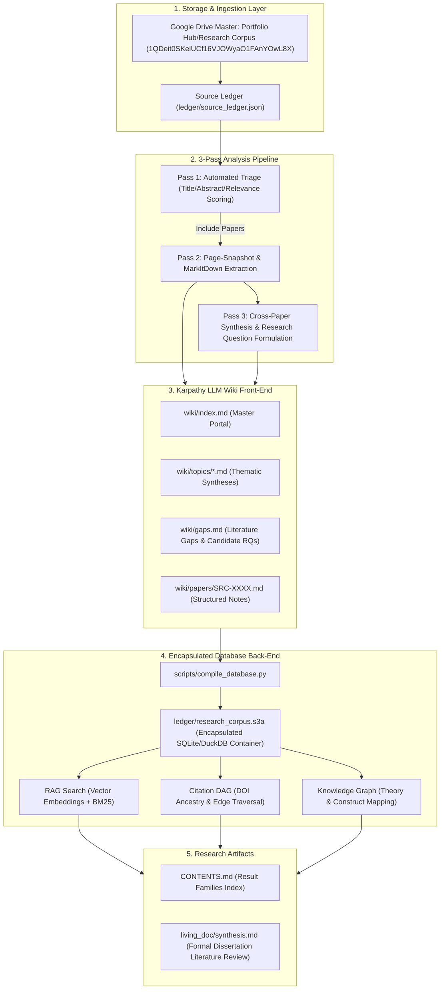

# 3Pass Research Corpus: Structure, Code, and Verification System

*   **Author:** Ashley & Antigravity
*   **Status:** Draft
*   **Date:** 2026-11-01

--------------------------------------------------------------------------------

## Overview

This design establishes a reproducible research and literature review pipeline modeled after OpenAI's `openai/math` repository workflow and Andrej Karpathy's LLM Wiki architecture (`Astro-Han/karpathy-llm-wiki`), adapted for doctoral literature reviews. Rather than treating academic literature as opaque PDF documents or overwhelming researchers with 800 to 1,500 loose files and nested folders, this system ingests papers directly from Google Drive, deconstructs them through multi-pass analysis, and provides an evolving research knowledge base.

The architecture adopts **Option C (Hybrid Architecture)**:
1. **Human-Agent Working Front-End (Karpathy LLM Wiki)**: An interconnected, human-readable Markdown wiki (`wiki/`) containing synthesized topic articles, paper summaries, concept links, and a dedicated research gap register (`wiki/gaps.md`) to assist the doctoral researcher in discovering literature gaps and formulating research questions.
2. **High-Performance Storage & Agent Back-End (`.s3a` Database Container)**: An encapsulated, single-file database (`research_corpus.s3a`) that packs all deconstructed markdown sections, extracted tables, metadata, vector embeddings, and citation DAG edges to power fast agentic queries (RAG, DAG, Graph) without disk or cloud-sync degradation.

--------------------------------------------------------------------------------

## The Problem

### 1. The PDF Ingestion Bottleneck
PDF is an end-of-line presentation format designed for visual rendering, not agentic comprehension:
* Multi-column text flow, hyphenated line wraps, and footnote interruptions corrupt token streams.
* Mathematical equations are rendered into disconnected glyphs and bounding boxes rather than semantic formulas.
* Tables and vector figures lose tabular hierarchy, column alignment, and structural relations unless processed through expensive vision-language models (VLMs).
* The original authoring structure (LaTeX source files, BibTeX citation records, clean table markup, and build recipes) is discarded during compilation into PDF.

### 2. The Doctoral Discovery Dilemma
A doctoral student conducting a literature review does not start with fully formed research questions (RQs). Instead, the review is the vehicle for:
* Mapping the existing academic landscape across 700+ papers.
* Detecting unresolved tensions, contradictory findings, and methodological blind spots (the "research gaps").
* Progressively formulating and refining their thesis topic and research questions through iterative passes (Pass 1 triage -> Pass 2 deep reading -> Pass 3 synthesis).
* Preventing cognitive collapse: A doctoral student cannot manually navigate 1,500 individual folders or parse fragmented raw PDF extractions without a unified knowledge architecture.

--------------------------------------------------------------------------------

## Goals

*   **Google Drive Integration**: Ingest the active corpus directly from the authoritative Google Drive folder:
    *   URL: `https://drive.google.com/drive/folders/1QDeit0SKelUCf16VJOWyaO1FAnYOwL8X`
    *   Local Mount Path: `G:\My Drive\Portfolio Hub\Research Corpus` (721+ items).
*   **Automated 3-Pass Progression**:
    *   **Pass 1 (Automated Triage)**: Fast scanning of title, abstract, and keywords; generates relevance scores (Evidence Evaluation, Learner Agency, Traceable Workflows) and marks Include/Maybe/Exclude in the master ledger.
    *   **Pass 2 (Deep Decomposition & Gaps)**: Extracts key methodology, tabular data, and claims; identifies unresolved questions and research gaps.
    *   **Pass 3 (Synthesis & Theory Grounding)**: Cross-paper comparative analysis, citation DAG lineage, and theory matrix mapping.
*   **Karpathy LLM Research Wiki (`wiki/`)**: Maintain a clean, human-navigable markdown wiki with:
    *   `wiki/index.md`: Master portal and taxonomy index.
    *   `wiki/topics/`: Synthesis articles for emerging themes.
    *   `wiki/gaps.md`: Active register of identified literature gaps and candidate research questions.
    *   `wiki/papers/`: Structured per-paper study notes linked to stable Source IDs.
*   **Encapsulated Database Container (`research_corpus.s3a`)**: Compile all wiki markdown files, extracted tables, metadata, and citation DAG edges into a single queryable file backing:
    *   **RAG Engine**: Dense vector embeddings + BM25 keyword search over Markdown sections and tables.
    *   **DAG Engine**: Citation hierarchy and DOI lineage tracking to trace parent theories and downstream empirical replications.
    *   **Graph Engine**: Concept and entity-relationship graph connecting theoretical frameworks, research questions, and findings.
*   **Standardized Global Catalog (`CONTENTS.md`)**: Generate an `openai/math` style catalog organized into Result Families, indicating theoretical alignment, code availability, and verification state.

--------------------------------------------------------------------------------

## Non-Goals

*   **Generating Deep Folder Trees for 1,500 Papers**: We will not create separate subfolders on Google Drive for every paper. Raw master PDFs remain in Drive, and structured representations are encapsulated within the `.s3a` database and the consolidated `wiki/` directory.
*   **Universal VLM OCR on Every Figure**: High-compute vision processing for figures and complex diagrams is applied selectively during Pass 2/3 for included papers, preventing wasted compute on marginal or administrative files.
*   **Mandatory Formal Theorem Proving (Lean 4)**: Machine verification focuses on runnable Python reproduction scripts, dataset validation, and citation integrity rather than pure mathematical theorem proofs.

--------------------------------------------------------------------------------

## Critical User Journeys (CUJs)

### CUJ 1: Automated Pass 1 Ingestion from Google Drive
*   **Given**: 721+ papers in `G:\My Drive\Portfolio Hub\Research Corpus` (`1QDeit0SKelUCf16VJOWyaO1FAnYOwL8X`).
*   **When**: The user runs `python scripts/ingest_drive.py`.
*   **Then**: The pipeline inventories metadata, assigns stable Source IDs, hashes content, extracts abstracts, and populates `ledger/source_ledger.json` without creating local folder bloat.

### CUJ 2: Discovering Research Gaps & Formulating Research Questions (Pass 2)
*   **Given**: The researcher has papers marked "Include" from Pass 1 but no established research question.
*   **When**: The researcher executes Pass 2 on a thematic cluster via `python scripts/run_pass2.py --topic "AI Scaffolding"`.
*   **Then**: The system extracts structured claims, updates `wiki/gaps.md` with identified contradictions and unexamined areas, and drafts candidate research questions in `wiki/topics/ai_scaffolding.md`.

### CUJ 3: Compiling Wiki into the `.s3a` Database and Running Tri-Modal Queries
*   **Given**: An updated `wiki/` directory with study notes, topic pages, and gap entries.
*   **When**: The user runs `python scripts/compile_database.py` and subsequently queries via `python scripts/query_engine.py --mode hybrid --query "How does cognitive load change with agentic reasoning traces?"`.
*   **Then**: The database updates its internal vector, DAG, and Graph tables, retrieves the exact cited passages, and maps the theoretical lineage back to foundational cognitive load papers.

--------------------------------------------------------------------------------

## Technical Plan (Architecture)

### 1. High-Level Architecture Overview



---

## Alternatives Considered

### Option A: Pure LaTeX Recovery & Source Deconstruction (`openai/math` Model)
*   **Mechanism**: Attempt to reconstruct raw LaTeX authoring source for every paper by fetching from arXiv or transpiling.
*   **Reason for Rejection**: Severe availability bottleneck for educational and empirical publications where TeX sources are private; decompiling non-math PDFs is brittle and error-prone.

### Option B: Page-Snapshot to Incremental LLM Wiki (`karpathy-llm-wiki` Model)
*   **Mechanism**: Maintain exclusively a flat collection of interlinked Markdown files without an underlying binary database.
*   **Reason for Rejection**: While excellent for human browsing, relying solely on text files creates high token latency and clumsy graph traversals when scaling agent queries across 800+ papers.

### Option C: Hybrid Architecture (Selected)
*   **Mechanism**: Combines a human-readable Karpathy Research Wiki front-end with an encapsulated `.s3a` database container back-end.
*   **Reason for Selection**: Solves the doctoral researcher's discovery dilemma by providing an intuitive wiki to track emerging research questions and literature gaps, while the `.s3a` database provides high-speed vector, citation DAG, and knowledge graph queries without file-system clutter.

--------------------------------------------------------------------------------

## Non-Functional Requirements

*   **Cloud-Sync & Storage Safety**: Google Drive for Desktop must only sync raw master PDFs and top-level synthesis documents. Intermediate build caches, local virtualenvs, and high-frequency SQLite locks on `research_corpus.s3a` must remain in local project storage (`c:\Users\Ashley\Downloads\3Pass\ledger\`) to prevent sync degradation.
*   **Performance & Latency**: Full-text and vector RAG queries over 800+ papers must execute in under 500ms using local embedded vector indices (e.g. `sqlite-vec` or DuckDB VSS).
*   **Reproducibility**: Every claim, summary, and gap entry in the wiki must maintain permanent provenance anchors: `[Source ID | Drive Path | Pass Level]`.

--------------------------------------------------------------------------------

## Detailed Implementation Plan

### Target Files to Create/Modify

#### 1. `config/corpus_config.yaml` (Create)
*   **Type / Scope**: YAML Configuration
*   **Proposed Changes**: Configures paths and environment parameters:
    *   `drive_folder_id`: `"1QDeit0SKelUCf16VJOWyaO1FAnYOwL8X"`
    *   `drive_local_path`: `"G:\\My Drive\\Portfolio Hub\\Research Corpus"`
    *   `database_path`: `"ledger/research_corpus.s3a"`
    *   `wiki_dir`: `"wiki"`
    *   `catalog_path`: `"CONTENTS.md"`
*   **Rationale**: Centralizes all storage and pipeline coordinates so scripts avoid hardcoded paths.

#### 2. `scripts/ingest_drive.py` (Create)
*   **Type / Scope**: Python Ingestion Script
*   **Proposed Changes**: Scans `G:\My Drive\Portfolio Hub\Research Corpus`, computes SHA-256 hashes, extracts baseline metadata and abstracts via PyMuPDF/MarkItDown, scores papers across the 3 project dimensions (Evidence Evaluation, Learner Agency, Traceable Workflows), and updates `ledger/source_ledger.json`.
*   **Rationale**: Implements automated Pass 1 intake directly from the user's authoritative Google Drive folder.

#### 3. `scripts/snapshot_extractor.py` (Create)
*   **Type / Scope**: Python Extraction Utility
*   **Proposed Changes**: For Pass 2 candidate papers, renders visual page snapshots of tables and figures, executes MarkItDown extraction with LaTeX math formula preservation, and formats output into clean Markdown.
*   **Rationale**: Solves the PDF ingestion bottleneck by deconstructing complex multi-column layouts and mathematical formulas before wiki ingestion.

#### 4. `scripts/wiki_manager.py` (Create)
*   **Type / Scope**: Python Knowledge Base Manager
*   **Proposed Changes**: Implements the Karpathy LLM Wiki engine:
    *   Initializes and lints `wiki/index.md`.
    *   Appends structured per-paper notes into `wiki/papers/SRC-XXXX.md`.
    *   Extracts unresolved questions and updates the literature gap register (`wiki/gaps.md`).
    *   Generates and updates thematic topic pages in `wiki/topics/`.
*   **Rationale**: Provides the human-navigable workspace where the doctoral student explores themes, identifies literature gaps, and formulates research questions.

#### 5. `scripts/compile_database.py` (Create)
*   **Type / Scope**: Python Database Compiler
*   **Proposed Changes**: Reads all wiki articles, extracted tables, metadata records, and citation edges, and compiles them into `ledger/research_corpus.s3a` (SQLite database with tables for `sources`, `sections`, `vectors`, `citation_dag`, and `concept_graph`).
*   **Rationale**: Encapsulates all corpus data into a single portable file, eliminating disk-clutter while powering high-speed agent queries.

#### 6. `scripts/query_engine.py` (Create)
*   **Type / Scope**: Python Query Engine & CLI
*   **Proposed Changes**: CLI interface providing three query modes:
    *   `--mode rag`: Semantic vector search across sections and tables.
    *   `--mode dag`: Bidirectional citation tree traversal from DOIs.
    *   `--mode graph`: Conceptual entity mapping across theoretical frameworks and constructs.
*   **Rationale**: Enables AI agents and the researcher to query the corpus as a unified RAG, DAG, and Graph.

#### 7. `scripts/generate_catalog.py` (Create)
*   **Type / Scope**: Python Catalog Generator
*   **Proposed Changes**: Reads the database and compiles `CONTENTS.md` organized into Result Families mirroring `openai/math`.
*   **Rationale**: Delivers a standardized, high-level index of the research corpus.

#### 8. `wiki/index.md`, `wiki/gaps.md`, `wiki/theories.md` (Create)
*   **Type / Scope**: Markdown Wiki Foundations
*   **Proposed Changes**:
    *   `wiki/index.md`: Master directory and navigation map.
    *   `wiki/gaps.md`: Active research gap register logging contradictions, unanswered empirical questions, and draft research questions.
    *   `wiki/theories.md`: Catalog of theoretical frameworks mapped across the corpus.
*   **Rationale**: Establishes the initial structure for the Karpathy research wiki.

#### 9. `tests/test_pipeline.py` (Create)
*   **Type / Scope**: Python Unit & Integration Tests
*   **Proposed Changes**: Tests Drive scanning, MarkItDown extraction, wiki file creation, database compilation, and RAG/DAG query execution.
*   **Rationale**: Verifies that all components function cohesively.

#### 10. `README.md` (Modify)
*   **Type / Scope**: Project Documentation
*   **Proposed Changes**: Documents the 3-pass workflow, the Karpathy wiki structure, the `.s3a` database engine, and CLI command references.
*   **Rationale**: Keeps project instructions accurate and synchronized.

---

### Verification Plan

*   **Unit Tests (`pytest tests/test_pipeline.py`)**:
    *   Verify SHA-256 deduplication and metadata extraction on sample PDFs.
    *   Verify MarkItDown extraction with LaTeX formula and table preservation.
    *   Verify `compile_database.py` generates valid SQLite schema with `sources`, `sections`, and `citation_dag` tables.
*   **Wiki Linting (`python scripts/wiki_manager.py --lint`)**:
    *   Verify all internal wikilinks resolve cleanly.
    *   Assert that every paper note in `wiki/papers/` maintains a valid provenance header.
*   **Query Engine Verification**:
    *   Execute test queries across RAG, DAG, and Graph modes:
        ```powershell
        python scripts/query_engine.py --mode rag --query "human AI synergy IRT"
        python scripts/query_engine.py --mode dag --id SRC-0006
        python scripts/query_engine.py --mode graph --theory "Learner Agency"
        ```
    *   Assert non-empty, cited results returned in under 500ms.

--------------------------------------------------------------------------------

*Drafted with EGM*
