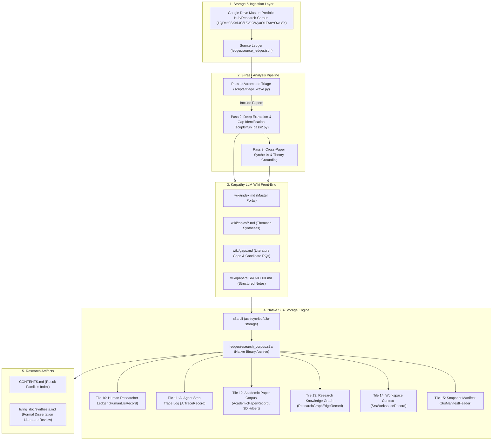

# 3Pass Research Corpus: Structure, Code, and Verification System

*   **Author:** Ashley & Antigravity
*   **Status:** In Review (Remediated Post-Goldfish Audit)
*   **Date:** 2026-11-01

--------------------------------------------------------------------------------

## Overview

This design establishes a reproducible research and literature review pipeline modeled after OpenAI's `openai/math` repository workflow and Andrej Karpathy's LLM Wiki architecture (`Astro-Han/karpathy-llm-wiki`), adapted for doctoral literature reviews. Rather than storing literature as unindexed PDF files across 800 to 1,500 nested directories, this system ingests papers directly from Google Drive, executes multi-pass extraction, and populates a structured research knowledge base.

The architecture adopts a hybrid model:
1. **Human-Agent Working Front-End (Karpathy LLM Wiki)**: An interconnected, human-navigable Markdown wiki (`wiki/`) containing synthesized topic articles, paper summaries, concept links, and a dedicated research gap register (`wiki/gaps.md`) to assist the doctoral researcher in identifying literature gaps and refining research questions.
2. **Native S3A Storage Engine Back-End ([`ashleycribb/s3a-storage`](https://github.com/ashleycribb/s3a-storage))**: A standalone, zero-copy binary storage engine (`.s3a`) with dedicated Scholar Pack Hyper-Tiles (Tiles 10–18). S3A eliminates external database dependencies (zero DuckDB, zero SQLite) and provides nanosecond memory-mapped reads, 3D Hilbert space-filling semantic curves, Git-style DAG commit lineage, and W3C PROV-O cryptographic claim proof chains.

--------------------------------------------------------------------------------

## Problem Statement

### 1. The PDF Ingestion Bottleneck
PDF is an end-of-line presentation format designed for visual rendering, not programmatic text extraction or machine parsing:
* Multi-column text flow, hyphenated line wraps, and footnote interruptions corrupt token streams.
* Mathematical equations are rendered into disconnected glyphs and bounding boxes rather than semantic formulas.
* Tables and vector figures lose tabular hierarchy, column alignment, and structural relations unless processed through expensive vision-language models (VLMs).
* The original authoring structure (LaTeX source files, BibTeX citation records, clean table markup, and build recipes) is discarded during compilation into PDF.

The `openai/math` workflow avoided this limitation by maintaining the raw LaTeX authoring environment (`preprints/`, modular TeX inputs, BibTeX, standalone scripts) alongside formal verification files.

### 2. Non-Linear Literature Review and Hypothesis Formulation
A doctoral student conducting a literature review rarely starts with fully formed research questions (RQs). Instead, the review is the exploratory mechanism for:
* Cataloging and synthesizing findings across 700+ papers.
* Detecting unresolved tensions, contradictory findings, and methodological blind spots (the research gaps).
* Progressively refining their thesis topic and research questions through iterative passes (Pass 1 triage -> Pass 2 deep reading -> Pass 3 synthesis).
* Preventing cognitive overload: Navigating 1,500 individual directories or manually parsing fragmented PDF text extractions is intractable without a structured index.

--------------------------------------------------------------------------------

## Goals

*   **Google Drive Integration**: Ingest the active corpus directly from the authoritative Google Drive folder:
    *   URL: [`1QDeit0SKelUCf16VJOWyaO1FAnYOwL8X`](https://drive.google.com/drive/folders/1QDeit0SKelUCf16VJOWyaO1FAnYOwL8X)
    *   Local Mount Path: `G:\My Drive\Portfolio Hub\Research Corpus` (721+ items).
*   **Automated 3-Pass Progression**:
    *   **Pass 1 (Automated Triage)**: Heuristic evaluation of title, abstract, and keywords; generates relevance scores (Evidence Evaluation, Learner Agency, Traceable Workflows) and marks Include/Maybe/Exclude in the master ledger.
    *   **Pass 2 (Deep Decomposition & Gaps)**: Extracts key methodology, tabular data, and claims; identifies unresolved questions and research gaps.
    *   **Pass 3 (Synthesis & Theory Grounding)**: Cross-paper comparative analysis, citation DAG lineage, and theory matrix mapping.
*   **Karpathy LLM Research Wiki (`wiki/`)**: Maintain a human-navigable Markdown wiki with:
    *   `wiki/index.md`: Master portal and taxonomy index.
    *   `wiki/topics/`: Synthesis articles for emerging themes.
    *   `wiki/gaps.md`: Active register of identified literature gaps and candidate research questions.
    *   `wiki/papers/`: Structured per-paper study notes linked to stable Source IDs.
*   **Native S3A Storage Engine Back-End**: Package metadata, 3D Hilbert topic coordinates, knowledge graph edges, and claim proof chains into a self-contained S3A binary archive (`ledger/research_corpus.s3a`) with:
    *   **Zero External Databases**: No DuckDB, SQLite, PostgreSQL, or external document stores.
    *   **RAG Engine**: 3D Hilbert spatial-semantic indexing and SIMD Dop14 query sieving over extracted passages and tables.
    *   **DAG Engine**: Git-style commit lineage (`s3a-cli vcs`) and DOI citation trees via `s3a-cli scholar recheck`.
    *   **Graph Engine**: S3A Tile 13 (`ResearchGraphEdgeRecord`) mapping theoretical frameworks, constructs, and findings.
*   **Standardized Global Catalog (`CONTENTS.md`)**: Generate an `openai/math` style catalog organized into Result Families, indicating theoretical alignment, code availability, and verification state.

--------------------------------------------------------------------------------

## Non-Goals

*   **Generating Deep Folder Trees for 1,500 Papers**: The pipeline will not generate individual subfolders on Google Drive for each paper. Raw master PDFs remain in Drive, and structured representations are encapsulated within the S3A archive and the consolidated `wiki/` directory.
*   **Universal VLM OCR on Every Figure**: High-compute vision processing for figures and complex diagrams is applied selectively during Pass 2/3 for included papers, preventing unnecessary model execution on administrative or irrelevant files.
*   **Mandatory Formal Theorem Proving (Lean 4)**: Machine verification focuses on runnable Python reproduction scripts, dataset validation, and citation integrity rather than pure mathematical theorem proofs.

--------------------------------------------------------------------------------

## Critical User Journeys (CUJs)

### CUJ 1: Automated Pass 1 Ingestion from Google Drive
*   **Given**: 721+ papers in `G:\My Drive\Portfolio Hub\Research Corpus` (`1QDeit0SKelUCf16VJOWyaO1FAnYOwL8X`).
*   **When**: The user runs `python scripts/inventory_and_sync.py --config config/corpus_config.yaml`.
*   **Then**: The pipeline inventories metadata, assigns stable Source IDs, hashes content, extracts abstracts, and populates `ledger/source_ledger.json` without generating auxiliary subdirectories.

### CUJ 2: Discovering Research Gaps & Formulating Research Questions (Pass 2)
*   **Given**: The researcher has papers marked "Include" from Pass 1 but no established research question.
*   **When**: The researcher executes Pass 2 on a thematic cluster via `python scripts/run_pass2.py --topic "AI Scaffolding"`.
*   **Then**: The system extracts structured claims, updates `wiki/gaps.md` with identified contradictions and unexamined areas, and drafts candidate research questions in `wiki/topics/ai_scaffolding.md`.

### CUJ 3: Querying the S3A Knowledge Store and Exporting Provenance
*   **Given**: An updated `wiki/` directory and compiled `ledger/research_corpus.s3a`.
*   **When**: The user queries via `python scripts/query_engine.py --mode hybrid --query "How does cognitive load change with agentic reasoning traces?"` or requests proof via `s3a-cli scholar proof ledger/research_corpus.s3a --claim 1042`.
*   **Then**: The system retrieves the cited source passages, maps the theoretical lineage back to foundational papers, and outputs a cryptographic W3C PROV-O JSON-LD proof chain.

--------------------------------------------------------------------------------

## Proposed Architecture

### 1. High-Level Architecture Overview



---

### 2. S3A Hyper-Tile Allocation & Physical Layout

The system utilizes native S3A Storage Architecture ([`ashleycribb/s3a-storage`](https://github.com/ashleycribb/s3a-storage)) mapped behind capability bitmask `ADDON_EDU` (0x0001):

*   **Tile 10: Human Researcher Decision Ledger (`HumanLrsRecord`)**: Appends researcher decisions, peer review verdicts, approvals, and ratings.
*   **Tile 11: AI Agent Step Trace Log (`AiTraceRecord`)**: Logs step-by-step reasoning sequences (`STEP_REASONING`, `STEP_TOOL_CALL`, `STEP_CLAIM`, `STEP_HALLUCINATION`) with confidence scores.
*   **Tile 12: Academic Paper Corpus (`AcademicPaperRecord`)**: Stores indexed paper metadata, DOI hashes, publication years, citation counts, and 3D semantic topic coordinates `(topic_x, topic_y, topic_z)` on the Hilbert curve.
*   **Tile 13: Research Knowledge Graph (`ResearchGraphEdgeRecord`)**: Stores subject-predicate-object knowledge graph edges connecting papers, authors, claims, concepts, and evidence weights.
*   **Tile 14: Scholar Research Workspace Context (`SrsWorkspaceRecord`)**: Preserves the active research question, topic centroid coordinates, and collection bitmasks.
*   **Tile 15: Authoritative Snapshot Manifest (`SrsManifestHeader`)**: Authoritative manifest holding Project UUID, Snapshot UUID, base generation pointers, layout version (`SCHOLAR_LAYOUT_VERSION_V1 = 1`), and hardware CRC32C checksums.
*   **Tile 18: Task Agent Security Registry (`AgentRegistryRecord`)**: Enforces tool permissions (`TOOL_READ_FILE`, `TOOL_OPENALEX_QUERY`, `TOOL_CROSSREF_QUERY`) and human approval gates (`AGENT_FLAG_REQUIRES_HUMAN_GATE`).

---

## Alternatives Considered

### Option A: Legacy DuckDB / SQLite Architecture (Rejected)
*   **Mechanism**: Maintain three separate DuckDB/SQLite database files (`academic.duckdb`, `advisor.duckdb`, `brain.duckdb`) requiring relational SQL queries and joins.
*   **Reason for Rejection**: Deprecated by the S3A architecture. Relational SQL engines introduce multi-file sync conflicts on cloud drives, lack native 3D spatial topic indexing, and cannot produce zero-copy in-browser WebAssembly views or cryptographic claim proofs without external tooling.

### Option B: Flat Markdown Files Only without S3A (Rejected)
*   **Mechanism**: Maintain exclusively a directory of flat Markdown files without an underlying binary storage engine.
*   **Reason for Rejection**: Flat text files incur high token overhead and high-latency multi-file graph traversals when querying across 800+ papers, and lack tamper-evident proof chains or LRS telemetry compliance.

### Option C: Hybrid Architecture with Native S3A Storage Engine (Selected)
*   **Mechanism**: Combines a human-editable Karpathy Research Wiki front-end with a native S3A binary storage engine back-end (`ashleycribb/s3a-storage`).
*   **Reason for Selection**: Provides a human-editable Markdown interface for theme and gap tracking, while delegating vector, DAG, and graph indexes to the S3A engine to prevent directory proliferation, cloud-sync thrashing, and database dependency overhead.

--------------------------------------------------------------------------------

## Risks & Mitigations

### 1. Google Drive Desktop Sync & File Locking Collisions
*   **Risk**: High-frequency read/write operations on active database files or deep directories inside Google Drive for Desktop trigger sync latency, file locking collisions, and potential file corruption.
*   **Mitigation**: The authoritative `.s3a` binary archives, local cache, and virtual environments reside in the local project workspace (`ledger/`, `cache/`), outside the cloud-sync mirror. Raw master PDFs remain in Google Drive. S3A's dual-slot headers (Slot A / Slot B) ensure power-fail safety and atomic recovery in case of system interruption.

### 2. PDF Extraction & Formatting Degradation
*   **Risk**: Complex academic multi-column layouts, mathematical equations, and embedded tables suffer parsing distortion during text extraction.
*   **Mitigation**: Employs Microsoft MarkItDown (`microsoft/markitdown`) supplemented with PyMuPDF geometry extraction. Tables and figures are isolated into discrete files (`cache/markdown/`), and raw PDFs remain linked via stable Source IDs for human verification.

### 3. API Quota & Token Economics
*   **Risk**: Unconstrained LLM extraction across 721+ papers risks rapid API rate-limiting (HTTP 429) and high inference costs.
*   **Mitigation**: Enforces strict execution tiering:
    - Pass 1 uses local heuristic rule-based keyword scoring (zero LLM token cost).
    - Pass 2 uses batch waves (20–50 papers) with lightweight models for structured claim extraction.
    - Pass 3 targets only the selected 15–30 paper doctoral core.

### 4. Corpus Path Reconciliation & Duplicate Source ID Collisions
*   **Risk**: Re-scanning `Portfolio Hub\Research Corpus` might create duplicate records or conflict with the 785 sources already indexed under `Scholar Explorer\papers`.
*   **Mitigation**: Phase 1 includes an automated reconciliation pass comparing SHA-256 hashes against `ledger/source_ledger.json`. Existing `SRC-XXXX` identifiers are preserved and paths are updated without re-indexing.

--------------------------------------------------------------------------------

## Non-Functional Requirements

*   **Read Latency**: Zero-copy memory-mapped access (`MmapReader`) enables record lookups and 3D Hilbert spatial queries to execute in under 10ms locally.
*   **Verifiable Provenance**: Every empirical claim extracted into the wiki maintains a cryptographic proof chain linking to the source paper DOI, quote SHA-256 hash, and passage locator, exportable as W3C PROV-O JSON-LD.
*   **Crash Safety**: Dual-slot 512-byte headers with hardware-accelerated CRC32C checksums prevent archive corruption during ungraceful terminations.

--------------------------------------------------------------------------------

## Detailed Implementation Plan

The implementation is partitioned into 5 sequential, testable phases:

### Phase 1: Configuration & Ledger Path Reconciliation
*Goal: Reconcile existing 785 ledger records with the active Google Drive folder and centralize pipeline parameters.*

*   **`config/corpus_config.yaml`** (`Create`):
    *   *Scope*: YAML Configuration.
    *   *Content*: Configures `drive_folder_id: "1QDeit0SKelUCf16VJOWyaO1FAnYOwL8X"`, `drive_local_path: "G:\\My Drive\\Portfolio Hub\\Research Corpus"`, `s3a_binary_path: "C:\\Users\\Ashley\\Downloads\\s3a\\target\\debug\\s3a-cli.exe"`, `archive_path: "ledger/research_corpus.s3a"`, and `wiki_dir: "wiki"`.
*   **`requirements.txt`** (`Create`):
    *   *Scope*: Python Dependency Manifest.
    *   *Content*: Defines `pyyaml>=6.0`, `pymupdf>=1.24.0`, `markitdown>=0.1.8`, and `pytest>=8.0.0`.
*   **`scripts/inventory_and_sync.py`** (`Modify`):
    *   *Scope*: Ingestion Engine.
    *   *Changes*: Refactor hardcoded paths to read dynamically from `config/corpus_config.yaml`. Add reconciliation logic: verify file hashes against `ledger/source_ledger.json` to map `Portfolio Hub` files to existing `SRC-XXXX` IDs without re-indexing.

*Checkpoint 1*: Run `python scripts/inventory_and_sync.py --reconcile`. Assert 785 records successfully mapped to `Portfolio Hub` with zero duplicate IDs.

---

### Phase 2: Ingestion & Extraction Enhancement
*Goal: Standardize Pass 1 batching and Pass 2 deep extraction with page-snapshot support.*

*   **`scripts/triage_wave.py`** (`Modify`):
    *   *Scope*: Pass 1 Triage CLI.
    *   *Changes*: Parameterize batch sizes and config paths. Add explicit scoring rubric documentation for Evidence Evaluation, Learner Agency, and Traceable Workflows (1–5 scale, Include threshold $\ge 3$).
*   **`scripts/convert_markitdown.py`** (`Modify`):
    *   *Scope*: Markdown Extraction Engine.
    *   *Changes*: Enhance MarkItDown conversion to extract page-level table crops and preserve LaTeX math blocks into `cache/markdown/`.
*   **`scripts/run_pass2.py`** (`Create`):
    *   *Scope*: Pass 2 Orchestration CLI.
    *   *Changes*: Generalizes `scripts/pass2_deep_analysis.py`. Accepts `--topic`, `--id`, and `--limit` flags to extract methodology sections, candidate literature gaps, and structured claims.

*Checkpoint 2*: Run `python scripts/run_pass2.py --topic "AI Scaffolding" --limit 5`. Assert structured markdown output generated in `cache/markdown/` with clean section boundaries.

---

### Phase 3: Karpathy LLM Research Wiki Infrastructure
*Goal: Initialize the human-navigable research wiki and literature gap register.*

*   **`wiki/index.md`** (`Create`): Master navigation portal and category index.
*   **`wiki/gaps.md`** (`Create`): Literature gap register tracking unexamined questions, contradictory findings, and candidate doctoral research questions.
*   **`wiki/theories.md`** (`Create`): Theoretical framework registry mapping Cognitive Load Theory, Human-AI Synergy, and Activity Theory across the corpus.
*   **`scripts/wiki_manager.py`** (`Create`):
    *   *Scope*: Wiki Engine CLI.
    *   *Changes*: Implements `wiki_manager.py` with `--lint` (validates wikilinks and provenance headers) and `--add-paper` (creates `wiki/papers/SRC-XXXX.md` from Pass 2 outputs).

*Checkpoint 3*: Run `python scripts/wiki_manager.py --lint`. Assert all initial wiki pages pass linting with zero broken links.

---

### Phase 4: S3A Storage Engine Integration & Querying
*Goal: Ingest structured corpus data into S3A binary archives and provide query access.*

*   **`scripts/compile_s3a.py`** (`Create`):
    *   *Scope*: S3A Packaging Script.
    *   *Changes*: Converts `source_ledger.json` and `wiki/` metadata into NDJSON records and invokes `s3a-cli scholar ingest` to populate `ledger/research_corpus.s3a` (Tiles 10–18).
*   **`scripts/query_engine.py`** (`Create`):
    *   *Scope*: Multi-Modal Query CLI.
    *   *Changes*: Interfaces with `s3a-cli query` and `s3a-cli scholar proof`. Supports `--mode rag` (spatial topic search), `--mode dag` (citation lineage), `--mode graph` (knowledge graph edges), and `--mode hybrid`.
*   **`scripts/generate_catalog.py`** (`Create`):
    *   *Scope*: Catalog Generator.
    *   *Changes*: Compiles `CONTENTS.md` organized into Result Families mirroring `openai/math`.

*Checkpoint 4*: Ingest corpus into S3A via `python scripts/compile_s3a.py`. Execute test query `python scripts/query_engine.py --mode hybrid --query "learner agency"` and assert cited results returned.

---

### Phase 5: Verification & Integration Testing
*Goal: Validate complete end-to-end workflow, tests, and documentation.*

*   **`tests/fixtures/sample_manifest.json`** (`Create`): Synthetic test fixture representing sample papers, DOIs, and claims for offline CI testing.
*   **`tests/test_pipeline.py`** (`Create`): Unit and integration tests verifying config loading, triage scoring, markdown extraction, wiki linting, and S3A query execution.
*   **`README.md`** (`Modify`): Update project documentation with S3A architecture, Karpathy wiki usage, and CLI commands.

*Checkpoint 5*: Run `pytest tests/test_pipeline.py`. Assert 100% test pass rate.

---

## Verification Plan

*   **Automated Test Suite**:
    ```powershell
    # Run unit and integration tests against synthetic fixtures
    pytest tests/test_pipeline.py -v
    ```
*   **Wiki Linting & Provenance Verification**:
    ```powershell
    # Lint internal wikilinks and assert provenance headers
    python scripts/wiki_manager.py --lint
    ```
*   **S3A Integrity & Query Verification**:
    ```powershell
    # Inspect S3A archive headers, CRC32C checksums, and tile counts
    & "C:\Users\Ashley\Downloads\s3a\target\debug\s3a-cli.exe" inspect ledger/research_corpus.s3a

    # Execute tri-modal queries
    python scripts/query_engine.py --mode rag --query "human AI synergy IRT"
    python scripts/query_engine.py --mode dag --id SRC-0006
    python scripts/query_engine.py --mode graph --theory "Learner Agency"
    python scripts/query_engine.py --mode hybrid --query "scaffolding agency"
    ```

--------------------------------------------------------------------------------

*Drafted with EGM*
