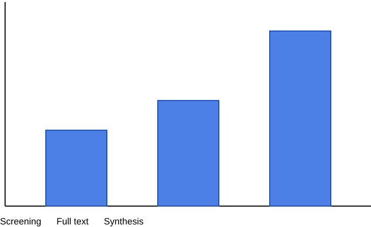

## Verified Extraction Test Paper

Test Author, Example University

## Abstract

We describe a small synthetic document used to check that extracted text, tables and figures match the original PDF without additions or omissions.

## 1 Introduction

This synthetic paper exists only to test the verified PDF path in 3Pass. It contains headings, body text, a ruled table, a vector chart and a short reference list. Doctoral students reviewing literature need extracted text that matches the source exactly. Every

block in this file can be checked against the PDF text layer and its page geometry.

## 2 Method

The table below reports invented counts for three review stages. The numbers have no meaning outside this test and were chosen so that each cell value is distinct.

Table 1: Invented counts per review stage.

| Stage     |   Papers |   Kept | Rate   |
|-----------|----------|--------|--------|
| Screening |      412 |    118 | 28.6%  |
| Full text |      118 |     47 | 39.8%  |
| Synthesis |       47 |     31 | 66.0%  |

Figure 1: Retention rate by stage (invented data).

## 3 Discussion

Because the chart is drawn with vector graphics, a converter must render the figure region rather than copy an embedded bitmap.

## References

- [1] S. Keshav. How to read a paper. ACM SIGCOMM Computer Communication Review, 2007.
- [2] H. Lightman et al. Let's verify step by step. arXiv preprint arXiv:2305.20050, 2023.
- [3] A. Example. A placeholder reference for parser testing. Test Journal, 2026.